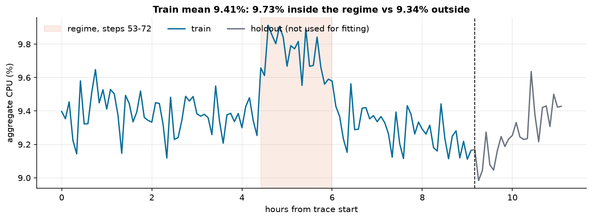
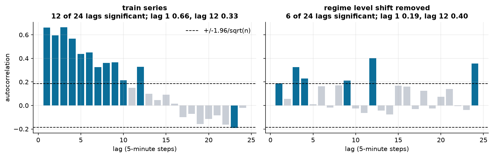
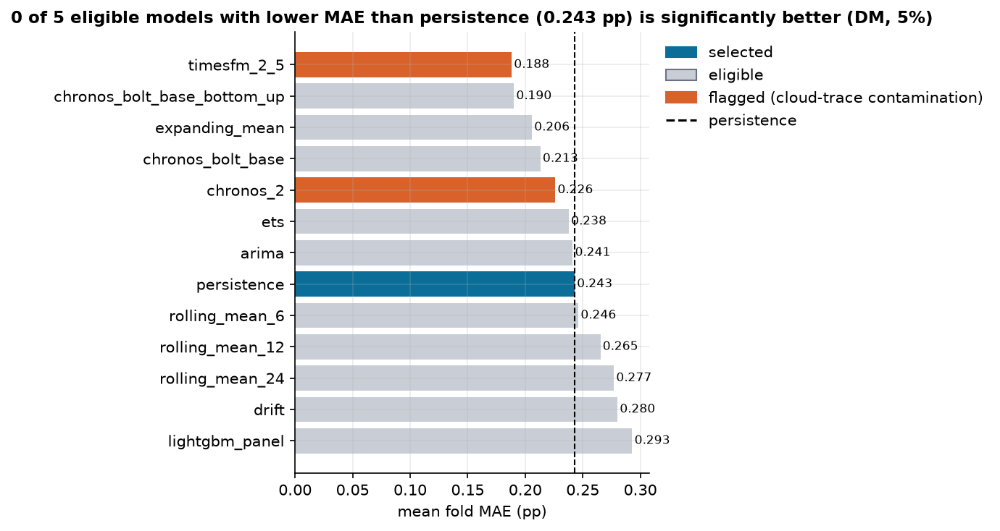
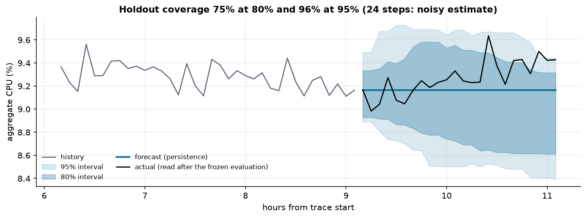
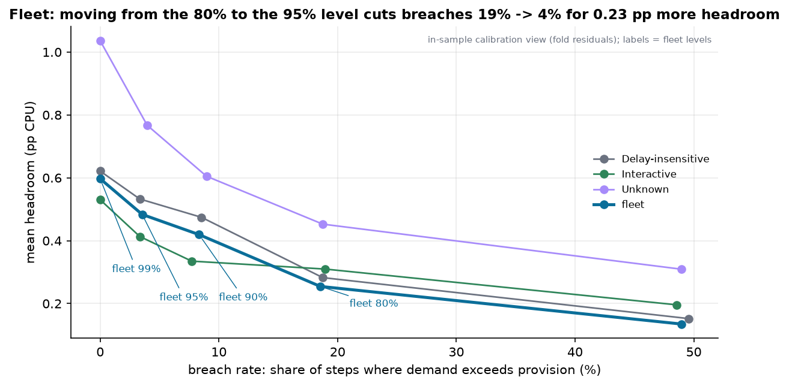

# Cloud Workload Forecasting: Final Report

Two-hour-ahead forecasting of fleet demand on the `data-v1` release of the Azure Public Dataset V2
(10,000 VMs, 134 five-minute steps). CPU is in percent and errors are in percentage points (pp). The numbers
come from `reports/artifacts/`, `reports/fm_contamination.md` and the executed notebook
`notebooks/analysis.ipynb`. The artifacts are gitignored; the commands in Appendix C regenerate them.

## 1. Executive summary

**No model beat the simplest forecast with evidence. The value lies in the headroom around it.**

- `active_vm_count` is 10,000 at every step because the release keeps only complete VM traces. Persistence
  is exact.
- For `aggregate_cpu_utilization`, persistence is selected. Five eligible models had a lower fold MAE than
  persistence (best 0.190 vs 0.243 pp), but none was significantly better (Diebold–Mariano p ≥ 0.30).
- The best raw score is TimesFM 2.5 (0.188 pp). It and Chronos-2 are ineligible: both were pretrained on
  Azure, Borg and Alibaba cluster traces.
- Holdout, scored once: MAE **0.147 pp** (about 1.6 % of the level), interval coverage **0.75** at 80 % and
  **0.958** at 95 %, MASE 1.21, peak-quartile MAE 0.309 pp.
- Recommendation: forecast level plus the **95 % one-sided conformal bound** per segment, with reactive
  autoscaling as a floor, an automatic rollback trigger and human sign-off. All inference is local.

## 2. Data understanding and preprocessing

**The data is clean. Two of its properties decide the approach: the VM count is fixed, and the metadata
leaks the future.**

The contract check found 1,340,000 rows and no missing timestamps, duplicates or invalid readings. The
contract is still enforced in code (Appendix D).

- **Constant count.** Every VM exists from the first step and none is deleted. This is a selection artefact,
  not cloud behaviour. Any model that deviates from 10,000 can only be worse.
- **Leakage.** The metadata fields `avg_cpu`, `max_cpu`, `p95_max_cpu` and `timestamp_vm_deleted` summarise
  each VM's 30-day life, which includes the holdout. They are never used as features. Only attributes known
  when a VM is created are allowed: category, cores and memory. The `>24` core bucket is assumed to be 32.
- **Fleet.** 6,180 Delay-insensitive, 3,091 Interactive and 729 Unknown VMs; 7,534 have 2 cores. Per-VM CPU
  is right-skewed (per-VM mean CPU over the 134 steps: median 5.5 %, mean 9.4 %).
- **Capacity target.** Capacity is consumed in cores, so the policy uses `core_weighted_cpu`. It correlates
  0.899 with the required target.

## 3. Workload analysis

**Fleet CPU is a flat, noisy level with one 100-minute regime, and most of its apparent memory comes from
that regime.**

Full-series descriptive statistics (including the holdout) appear only in this exploratory analysis and were never
used for any candidate, rule, threshold or level.


*Figure 1. Fleet CPU sits near 9.3–9.4 %, with one regime at steps 53–72 (9.73 % inside vs 9.34 % outside).*

- Training mean 9.41 %, holdout mean 9.27 %, standard deviation about 0.19 pp: the scale for every error
  below.
- The top-decile training steps (55–68) all fall inside the regime. Peaks were a single event here, not a
  recurring pattern.
- The trace covers 11.1 hours, so a daily cycle cannot be identified.


*Figure 2. 12 of 24 lags are significant on the training series. With the regime's level shift removed,
6 remain and lag 1 falls from 0.66 to 0.19.*

Most of the hour-long memory is the regime's 20-step shift. What remains is weak, except for spikes at lag 12 (0.40) and lag 24 (about 0.36). Those could be an hourly
pattern. The evidence is fragile (24 lags estimated from 110 points), and a period-12 seasonal-naive model
was not tested.

**Segments** share the shape. The smaller ones are noisier: training standard deviation 0.22 pp
(Delay-insensitive), 0.24 pp (Interactive) and 0.63 pp (Unknown). Headroom is therefore set per segment.

## 4. Forecasting approach

**Baselines first. Complex models are challengers that must beat them with evidence.**

| Family | Models | Complexity |
|---|---|---|
| Naive | persistence | 0 |
| Simple | expanding mean, rolling means (6/12/24), drift | 1 |
| Statistical | ETS, ARIMA | 2 |
| Machine learning | global LightGBM on the VM panel, summed over VMs | 3 |
| Foundation models, zero-shot | Chronos-Bolt-base (fleet and bottom-up), Chronos-2, TimesFM 2.5 | 4 |

**LightGBM** learns from all VMs together. Its features are per-VM and fleet lags, rolling statistics, an
exponentially weighted mean, the horizon and the static attributes. Its gain is dominated by smoothed levels
(`ewm_12` alone has 44 %), so in effect it learns a smoothed level.

**Foundation models** run locally from published weights. Their pretraining corpora were checked first
(`reports/fm_contamination.md`):

- Chronos-2 lists Azure VM Traces 2017, Alibaba 2018 and Borg 2011.
- TimesFM 2.5 inherits the same three traces through GIFT-Eval Pretrain.

Both are reported but cannot be selected. Chronos-Bolt-base documents no cloud traces, but its corpus is not
public, so it is eligible with that caveat.

**Selection rule.** The lowest mean fold MAE wins, but a more complex model must beat every simpler one with
a Diebold–Mariano test at p < 0.05. Otherwise the simplest model that is not significantly worse is chosen.
With a 0.19 pp signal, MAE alone would select noise. LightGBM and the foundation models are opt-in in the
default command, and neither would change the selection.

## 5. Validation methodology

**Rolling-origin backtests inside the training window. The holdout was touched once.**

- **Holdout.** The final 24 steps. They were never used for fitting, features, tuning, selection or policy
  parameters, and were scored once after selection was frozen.
- **Folds.** 20 origins (steps 48, 50, …, 86), each forecasting 24 steps ahead. Models see only the panel
  truncated at the origin.
- **Metrics.** MAE (primary), RMSE, MASE, mean signed error, top-quartile MAE and interval coverage.
- **Significance.** Diebold–Mariano with a Newey–West variance and the Harvey–Leybourne–Newbold correction.
  Its simulated false-positive rate is 1.4 % at α = 0.05. The DM test is run on the 20 per-fold MAEs,
  with Newey–West lag truncation h = ⌈24/2⌉ = 12.
- **Intervals.** Split-conformal, from the selected model's fold residuals, pooled over horizons h ± 2.

The test is conservative and low-powered. The 20 folds overlap (origins 2 steps apart, horizon 24), so
"not significant" means "no reliable evidence of a difference", not "equal".

## 6. Results versus baseline

**No eligible model is significantly better than persistence.**


*Figure 3. Five eligible models have a lower fold MAE than persistence (0.243 pp); none is significantly
better.*

| Model (aggregate CPU, 20 folds) | MAE (pp) | Mean error | DM p vs persistence | Eligible |
|---|---:|---:|---:|---|
| TimesFM 2.5 | 0.188 | −0.047 | — | no |
| Chronos-Bolt bottom-up | 0.190 | +0.064 | 0.51 | yes |
| expanding mean | 0.206 | +0.003 | 0.62 | yes |
| Chronos-Bolt | 0.213 | −0.072 | 0.30 | yes |
| Chronos-2 | 0.226 | −0.093 | — | no |
| ETS / ARIMA | 0.238 / 0.241 | −0.098 / −0.068 | 0.74 / 0.93 | yes |
| **persistence** | **0.243** | −0.128 | — | yes |
| LightGBM panel | 0.293 | −0.145 | 0.42 | yes |

Across all 55 pairs of eligible models, the smallest DM p-value is 0.060. In the default candidate set, the
expanding mean has the lowest MAE, but persistence is not significantly worse (p = 0.617). Appendix B has the
full table and Appendix D the inference cost per model.

**Holdout (one evaluation, flat forecast 9.165 %).**

| Target | MAE | RMSE | MASE | Peak-quartile MAE | Coverage 80 % | Coverage 95 % |
|---|---:|---:|---:|---:|---:|---:|
| aggregate CPU (pp) | 0.147 | 0.185 | 1.21 | 0.309 | 0.75 | 0.958 |
| active VM count | 0 | 0 | 0 | 0 | 1.00 | 1.00 |

The holdout MAE is below the fold MAE (0.243 pp) because the holdout origin lies outside the regime, while half the fold origins lie inside it; 24 points cannot
rank models. MASE scales by the one-step naive error (0.121 pp), so above 1 is expected at 24 steps (fold
MASE 2.01). All 6 misses of the 80 % band were above it.

## 7. Error and failure analysis

**Forecasts fail when the regime changes, and the models with the best average error fail worst at peaks.**

1. **Regime ends.** 10 of the 20 origins lie inside the regime. Persistence carries the high level forward
   and the mean error (actual − pred) is −0.28 pp from those origins (over-prediction), against +0.02 pp
   elsewhere (slight under-prediction). This one event dominates the fold averages.
2. **Peaks.** On the top quartile of fold steps, persistence's MAE is 0.225 pp. That is partly a selection
   effect: high actuals cluster in the regime, where persistence also forecasts high. The models that look
   best on average degrade sharply on these steps: expanding mean 0.206 → 0.346 pp, Chronos-Bolt bottom-up
   0.190 → 0.388 pp. They forecast the long-run level and lag every peak, and peaks are where
   under-provisioning happens.
3. **Holdout ending.** The series rose in its last hour while the forecast stayed flat. Every 80 % miss was
   above the band (mean position: step 21 of 24). The intervals are asymmetric (0.28 pp up vs 0.43 pp down)
   because the fold residuals were dominated by over-prediction after the regime.
4. **Horizon.** Fold MAE falls with the horizon (expanding mean 0.20 → 0.16 pp). This reflects how the folds
   are laid out: 95 % of the 24-step targets fall after the regime.


*Figure 4. Holdout coverage is 75 % at 80 % and 96 % at 95 %. Every miss is an under-forecast in the final
hour.*

**A bug worth reporting.** The first bottom-up Chronos-Bolt forecast summed per-VM forecast *medians*. It
scored MAE 0.451 pp, all of it bias. VM CPU is right-skewed, so medians understate the fleet mean (by
0.64 pp across VMs). Averaging the forecast deciles instead brought the MAE to **0.190 pp**. The residual
+0.064 pp bias comes from the trimmed top tail.

## 8. Capacity-planning recommendation

**Provision each segment at its forecast level plus the 95 % one-sided conformal bound. Keep reactive scaling
underneath, and fall back automatically when the bound stops holding.**

Under-provisioning is priced at 10× over-provisioning. That makes the cost-minimising quantile 10/11 ≈ 0.91,
and on the in-sample curve (core-weighted CPU) 90 % is indeed cheapest in every segment:

| Segment | Level | Breach rate | Mean headroom (pp) | Expected cost |
|---|---:|---:|---:|---:|
| Fleet | 80 % | 18.5 % | 0.255 | 0.589 |
| Fleet | 90 % | 8.3 % | 0.419 | **0.466** |
| Fleet | 95 % | 3.5 % | 0.483 | 0.494 |
| Interactive | 90 % | 7.7 % | 0.335 | **0.404** |
| Interactive | 95 % | 3.3 % | 0.413 | 0.415 |


*Figure 5. Moving the fleet from the 80 % to the 95 % level cuts in-sample breaches from 19 % to 4 % for
0.23 pp more headroom.*

**Why 95 % and not 90 %.** The choice uses only the training window:

- The in-sample breach rates are optimistic by construction. Offsets are fitted and scored on the same
  overlapping folds.
- The cost curve is flat between 90 % and 95 %: +6 % expected cost for the fleet (+3 % for Interactive),
  while in-sample breaches more than halve. Under a 10:1 ratio, that is cheap insurance.
- The training window contains a regime shift, which breaks the exchangeability that split-conformal
  assumes. Interactive VMs are latency-sensitive, so a breach likely costs them more than 10:1.
- A temporal check on training folds only shows the calibration is unstable. Offsets were calibrated on the
  first 10 origins (48–66) and scored on the last 10 (68–86), then the reverse:

| Segment | Early → late, 90 % / 95 % | Late → early, 90 % / 95 % |
|---|---:|---:|
| Fleet | 0.4 % / 0.4 % | 28 % / 25 % |
| Interactive | 2.1 % / 0.0 % | 30 % / 20 % |
| Delay-insensitive | 0.4 % / 0.4 % | 37 % / 34 % |
| Unknown | 52 % / 33 % | 1.3 % / 0.4 % |

Out-of-sample breach rates swing from 0 % to 52 % against nominal targets of 10 % and 5 %, so no fixed level
is trustworthy alone. The higher level limits the damage; the rollback trigger handles the rest. The level
is a policy choice, made explicit so that it can be reviewed.

*Post-hoc check, made after the level was set and not used to choose anything:* on the holdout, the 90 %
one-sided bound for aggregate CPU (the upper edge of the 80 % interval) was exceeded on 6 of 24 steps. That
is consistent with the instability above.

**Runbook (every 5 minutes, per segment):**

1. **Baseline.** Use the selected point forecast: persistence for the fleet, Delay-insensitive and Unknown,
   and the expanding mean for Interactive. Interactive is the only place where a test separated models
   (p = 0.0017 against persistence).
2. **Provision** baseline + the 95 % offset for each of the next 24 steps (`upper_95` in
   `capacity_plan.csv`). Average headroom: fleet 0.35 pp, Interactive 0.32 pp, Delay-insensitive 0.42 pp,
   Unknown 0.57 pp of core-weighted CPU.
3. **Reactive floor.** The forecast is a floor, not a cap. If observed demand exceeds the provision, the
   reactive autoscaler scales out at once. Scale-in waits for the usual cooldown.
4. **Rollback.** Count breaches of the 95 % bound over the trailing 24 steps. At 4 or more, switch that
   segment to reactive-only and alert on-call. If the bound held, that would happen with probability 3 %.
   This false-alarm rate is a lower bound, because breaches cluster.
5. **Sign-off.** Changes to the level, the cost ratio, the model or the segments go through review. Each run
   records its selection and reasons in `selection.json`.

## 9. Limitations and future work

- **Short history.** 11.1 hours and 110 training steps, half the folds on one regime. Daily or weekly
  seasonality cannot be tested.
- **Low power.** Chronos-Bolt bottom-up may truly be better than persistence; this data cannot show it.
- **Small holdout.** 24 points: 6 misses of the 80 % band is within chance (4.8 expected), although all
  falling on one side is a warning.
- **Assumptions.** Under-provisioning costs 10× over-provisioning; the `>24` core bucket is 32 cores;
  Chronos-Bolt's eligibility rests on its documentation. The constant count says nothing about real churn.
- **Future work.** Test a period-12 seasonal-naive model and the lag-12/24 pattern on a longer trace.
  Replace fixed conformal offsets with adaptive conformal inference.

**Scaling to production.**

- **Hierarchy.** Forecast fleet → segment → VM and reconcile the levels with MinT.
- **Retraining.** Re-run selection daily on a rolling window. The default pipeline takes about 42 s for
  10,000 VMs, measured once on a laptop CPU. Model changes pass the same DM rule and sign-off.
- **Monitoring.** Track rolling MAE against persistence and rolling coverage per segment, with the
  Section 8 trigger as the first alarm. Adaptive conformal inference doubles as a drift alarm.
- **Cold-start VMs.** New VMs have no history; zero-shot foundation models help here, run locally after the
  same contamination check.
- **Cost per forecast.** Persistence is free. A bottom-up Chronos-Bolt refresh of 10,000 VMs would take
  about 2 s on a GPU or about 1 minute on a CPU, extrapolated ×10 from the 1,000-series benchmark. Pay that
  only where it shows a measurable gain.

---

## Appendix A. Decision index

Each decision has a one-line entry in [`devlog.txt`](../devlog.txt).

| Topic | Decision |
|---|---|
| Profile before modelling; data facts | D1 |
| Lifetime metadata never used as features | D2 |
| Approach: baselines + LightGBM + zero-shot FMs as challengers; local inference only | D3, D4 |
| Native 5-minute cadence | D5 |
| Core-weighted capacity targets; `>24` cores = 32 | D6 |
| Holdout = last 24 steps; 20 rolling origins | D7 |
| Selection: lowest MAE plus DM parsimony rule | D8 |
| Leakage-safe truncation at the origin | D9 |
| Nothing hard-coded to the data size; seed 0 | D10 |
| Single cleaning rule; off-grid timestamps rejected | D12 |
| DM with Newey–West and HLN correction | D13 |
| LightGBM panel construction | D14 |
| Foundation-model contamination gate | D15, D21 |
| Why fold MAE looks high; expanding-mean baseline | D16 |
| Bottom-up median → mean bug and fix | D17, D19 |
| Constant VM count | D18 |
| CPU selection result | D20 |
| CLI defaults (LightGBM and FMs opt-in) | D22 |
| Conformal intervals and capacity trade-off | D23 |
| Missing timestamps are NaN, not zero | D24 |
| Narrow CLI error handling | D25 |
| One-shot holdout evaluation | D26 |
| Separate benchmark command | D27 |
| ACF correction: regime-driven persistence | D28 |
| 95 % policy level, justified from training data only | D29 |
| No new models after the holdout evaluation | D30 |
| Report length held to the 4–6 page target | D31 |

## Appendix B. Full benchmark (aggregate CPU, 20 training folds)

Source: `benchmark_summary.csv`, `dm_matrix.csv`. "Seconds" is the wall time of the 20-fold backtest.

| Model | Complexity | MAE | RMSE | MASE | Mean error | DM p vs persistence | Seconds | Flagged |
|---|---:|---:|---:|---:|---:|---:|---:|---|
| timesfm_2_5 | 4 | 0.188 | 0.234 | 1.554 | −0.047 | — | 15.2 | yes |
| chronos_bolt_base_bottom_up | 4 | 0.190 | 0.244 | 1.570 | +0.064 | 0.512 | 45.3 | no |
| expanding_mean | 1 | 0.206 | 0.243 | 1.699 | +0.003 | 0.617 | 0.19 | no |
| chronos_bolt_base | 4 | 0.213 | 0.256 | 1.760 | −0.072 | 0.303 | 4.7 | no |
| chronos_2 | 4 | 0.226 | 0.276 | 1.867 | −0.093 | — | 3.4 | yes |
| ets | 2 | 0.238 | 0.289 | 1.964 | −0.098 | 0.741 | 1.4 | no |
| arima | 2 | 0.241 | 0.291 | 1.992 | −0.068 | 0.928 | 3.8 | no |
| persistence | 0 | 0.243 | 0.297 | 2.006 | −0.128 | — | 0.18 | no |
| rolling_mean_6 | 1 | 0.246 | 0.296 | 2.033 | −0.099 | 0.855 | 0.20 | no |
| rolling_mean_12 | 1 | 0.265 | 0.308 | 2.191 | −0.099 | 0.633 | 0.23 | no |
| rolling_mean_24 | 1 | 0.277 | 0.309 | 2.288 | −0.087 | 0.773 | 0.21 | no |
| drift | 1 | 0.280 | 0.348 | 2.313 | −0.165 | 0.240 | 0.20 | no |
| lightgbm_panel | 3 | 0.293 | 0.338 | 2.419 | −0.145 | 0.417 | 468.8 | no |

DM p-values are computed among eligible models only. For `active_vm_count` every model scores MAE 0, except
TimesFM 2.5 (0.0003 VMs, `benchmark_count_summary.csv`).

## Appendix C. Reproduction

`reports/artifacts/` is gitignored. From a clean checkout with `challenge_data/` extracted and verified (see
`README.md`), these commands regenerate it:

```bash
python -m pip install -e ".[dev]"
python -m pytest -q
python -m cwfc.predict --data challenge_data --output predictions.csv      # 42 s measured, CPU only
python -m cwfc.benchmark --data challenge_data --artifacts reports/artifacts --with-fm   # optional; needs [fm] and [timesfm]; practical runtime needs a GPU (CPU works, slowly)
python -m cwfc.evaluate --data challenge_data                                         # reads the holdout: run only after predict, once
python -m jupyter nbconvert --to notebook --execute --inplace notebooks/analysis.ipynb
```

`evaluate` is the one-shot holdout scoring. It was run once, after selection was frozen; rerunning it only
reproduces `holdout_eval.json`. A reviewer without a GPU can skip the benchmark: the committed, executed
notebook and Appendix B already show its results.

In a clean-checkout run, `predict` reproduced `predictions.csv` byte for byte (SHA-256 `61da69b0…2aef`; the output is written with LF line endings, so the hash holds on any platform),
together with `selection.json`, `intervals.csv`, `tradeoff.csv` and `capacity_plan.csv`. `evaluate`
reproduced `holdout_eval.json`.

## Appendix D. Data contract and inference cost

**Data contract** (`cwfc.data`). Contract check on `data-v1`: 1,340,000 rows, 10,000 VMs, 134 timestamps
300 s apart, and zero missing timestamps, duplicate rows, invalid readings or order violations. On other data:

- Invalid readings (missing ids, CPU outside [0, 100]) are dropped and counted.
- Duplicate `(vm, timestamp)` rows are averaged, so the result does not depend on row order.
- Off-grid timestamps raise an error instead of being moved into a neighbouring slot.
- A timestamp with no readings is missing: every target is NaN, never 0 and never carried forward.
- The holdout is always the last 24 steps of the supplied data. Nothing is hard-coded to this release.

**Inference cost** (`latency.csv`: 1,000 series, warm model, median of repeats):

| Model | ms per series, GPU | ms per series, CPU |
|---|---:|---:|
| persistence | — | 0.0002 |
| LightGBM panel (after fitting; the 20-fold backtest took 468.8 s) | — | 0.076 |
| Chronos-Bolt-base | 0.22 | 6.1 |
| Chronos-2 | 0.44 | 8.6 |
| TimesFM 2.5 | 8.1 | 99.8 |
